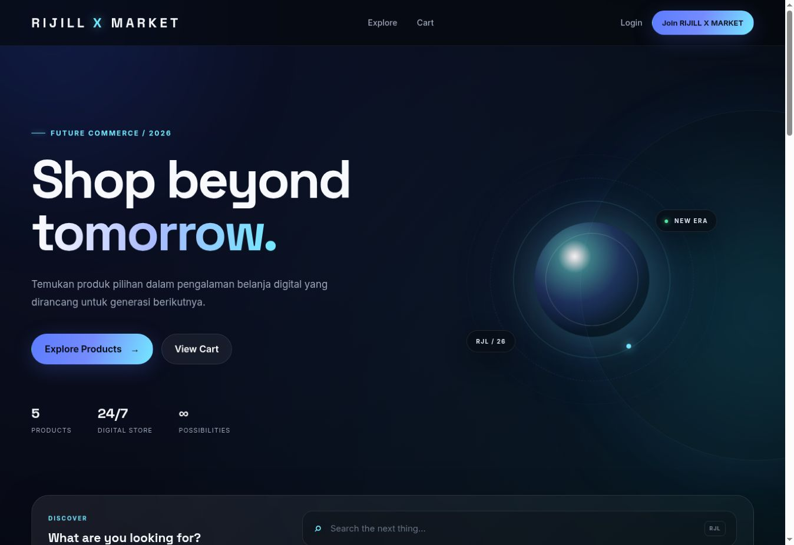
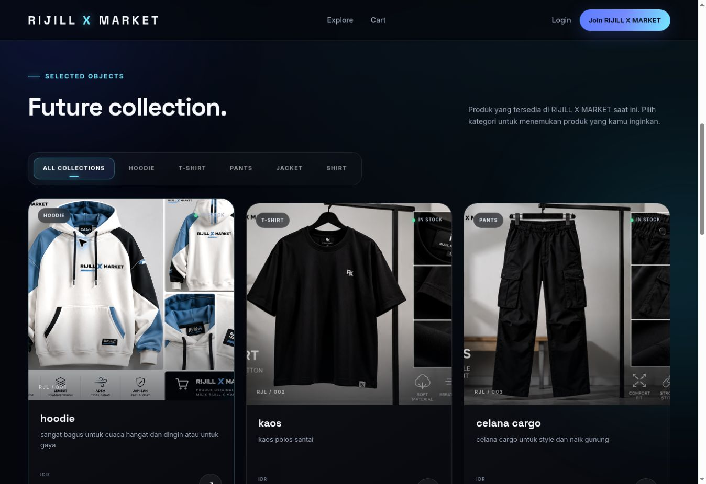
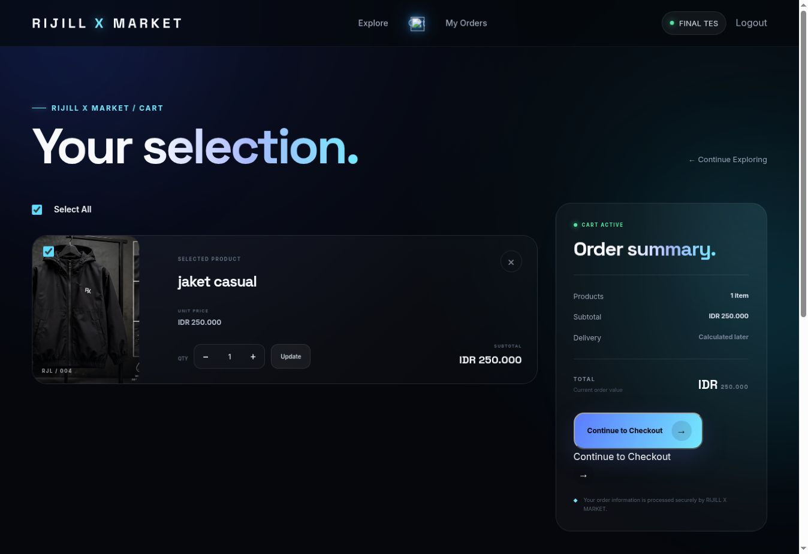
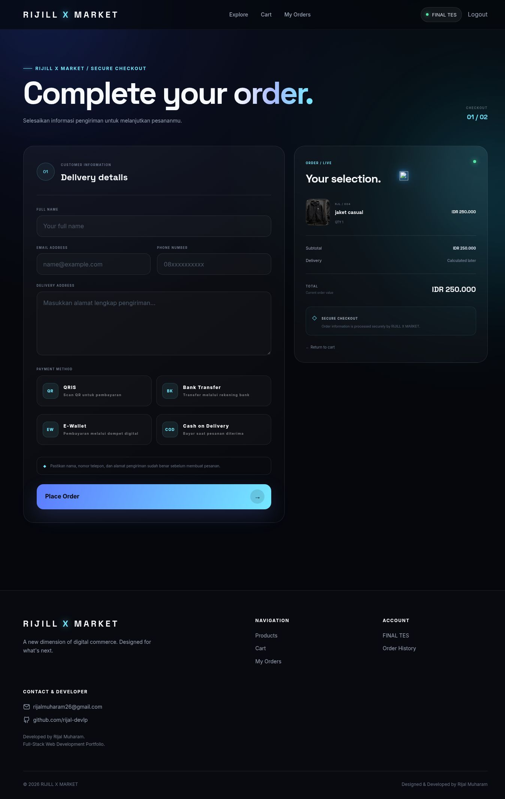

# RIJILL X MARKET

### Full-Stack E-Commerce Web Application

RIJILL X MARKET is a full-stack e-commerce web application developed using Laravel 12, PHP, MySQL, Blade, JavaScript, and Vite.

The project demonstrates an end-to-end online shopping workflow, including customer authentication, product browsing, cart management, checkout, order tracking, inventory management, and an administrative dashboard.

**Project Status:** Portfolio Project — Deployed Online and Manually Tested  
**Live Demo:** https://rijillxmarket.alwaysdata.net  
**Developer:** Rijal Muharam  
**GitHub:** [@rijal-devlp](https://github.com/rijal-devlp)  
**Repository:** [rijill-x-market](https://github.com/rijal-devlp/rijill-x-market)

> **Demo Notice:** This is a portfolio demonstration. Payment methods and payment status are simulated; no real payments are processed.

---

## Live Demo

**Website:** https://rijillxmarket.alwaysdata.net

The application is deployed on alwaysdata for portfolio demonstration.

Visitors can explore the product catalog and register a customer account to experience the shopping workflow.

Administrative features are restricted to authorized accounts. No public administrator credentials are provided.

**Important:** The checkout and payment flows are demonstrations only. Do not submit real payment information or attempt to make a real payment through this demo.

---

## Features

### Customer Features

- Customer registration and login
- Product catalog and category filtering
- Product search
- Product detail pages
- Persistent shopping cart
- Cart quantity management
- Partial checkout for selected cart items
- Checkout form with customer and shipping information
- Payment method selection:
  - QRIS
  - Bank transfer
  - E-wallet
  - Cash on Delivery (COD)
- Checkout success page
- Customer order history
- Detailed order information
- Payment status display (UNPAID / PAID)
- Order status tracking

### Admin Features

- Administrative dashboard with summary statistics
- Product management (Create, Read, Update, Delete)
- Product image upload
- Product category and stock management
- Soft deletion and product trash
- Restore deleted products
- Permanently delete products
- Customer order management
- Update order status:
  - Pending
  - Processing
  - Shipped
  - Completed
  - Cancelled
- Update payment status
- Role-based access restrictions

### Additional Functionality

- Database-backed cart storage
- Stock validation during checkout
- Database transactions and row locking for inventory consistency
- Product information snapshots in order history
- Preservation of order item details after product deletion
- Password hashing
- Login rate limiting
- Responsive interface
- Custom dark-themed user interface

---

## Technology Stack

| Technology | Purpose |
|---|---|
| Laravel 12 | Backend framework |
| PHP 8.2+ | Server-side programming |
| MySQL / MariaDB | Relational database |
| Blade | Server-rendered templates |
| HTML5 | Page structure |
| CSS3 | Custom styling and responsive layout |
| JavaScript | Frontend interactions |
| Vite | Frontend asset bundling |
| Composer | PHP dependency management |
| npm | JavaScript dependency management |
| Git & GitHub | Version control |
| alwaysdata | Web hosting and deployment |

---

## Screenshots

The following screenshots showcase the RIJILL X MARKET e-commerce application, including customer and administrator features.

### 1. Homepage

The main storefront featuring the RIJILL X MARKET shopping experience.



### 2. Product Catalog

Browse available products and explore the product collection.



### 3. Product Details

View detailed information about individual products.


### 4. Shopping Cart

Manage selected products and quantities before checkout.



### 5. Checkout

Enter shipping information and select a simulated payment method.



### 6. Customer Order History

Review previously placed orders and track their statuses.


### 7. Admin Dashboard

Administrative dashboard for monitoring store activities.


### 8. Admin Product Management

Create, update, and manage products and inventory.


### 9. Admin Order Management

Review customer orders and manage payment and shipping statuses.


### 10. Admin Product Trash

Manage soft-deleted products, including restoration and permanent deletion.


---

## Application Workflow

### Customer Workflow

1. Register or log in.
2. Browse products and search by name or category.
3. View product details.
4. Add products to the shopping cart.
5. Adjust product quantities.
6. Select items for checkout.
7. Enter shipping information.
8. Choose a payment method.
9. Place an order.
10. View order history and track order status.

### Administrator Workflow

1. Log in with an authorized administrator account.
2. Access dashboard statistics.
3. Create and manage products.
4. Review incoming customer orders.
5. Update order processing and shipping statuses.
6. Update payment status.
7. Manage deleted products.

---

## Installation

### Prerequisites

Make sure the following tools are installed:

- PHP 8.2 or a compatible version supported by the project
- Composer
- MySQL or MariaDB
- Node.js and npm
- Git

### 1. Clone the Repository

```bash
git clone https://github.com/rijal-devlp/rijill-x-market.git
cd rijill-x-market
```

### 2. Install PHP Dependencies

```bash
composer install
```

### 3. Install Frontend Dependencies

```bash
npm install
```

### 4. Configure the Environment

Copy the example environment file.

On Windows PowerShell:

```powershell
Copy-Item .env.example .env
```

On Linux or macOS:

```bash
cp .env.example .env
```

Generate an application key:

```bash
php artisan key:generate
```

### 5. Configure MySQL

Create a MySQL database named:

```text
toko_online
```

Update the database settings in `.env`:

```dotenv
APP_NAME="RIJILL X MARKET"
APP_ENV=local
APP_DEBUG=true
APP_URL=http://127.0.0.1:8000

DB_CONNECTION=mysql
DB_HOST=127.0.0.1
DB_PORT=3306
DB_DATABASE=toko_online
DB_USERNAME=root
DB_PASSWORD=
```

Adjust the database credentials to match your local environment.

**Important:** These settings are intended for local development only. Do not commit your actual `.env` file or production credentials.

### 6. Run Database Migrations

```bash
php artisan migrate
```

### 7. Create the Public Storage Link

```bash
php artisan storage:link
```

### 8. Start the Laravel Development Server

```bash
php artisan serve
```

### 9. Start Vite

Open another terminal and run:

```bash
npm run dev
```

### 10. Open the Application

Visit:

http://127.0.0.1:8000

An administrator account must be provisioned with the appropriate role before accessing administrative features.

Do not use default or publicly documented passwords in a deployed environment.

**Note:** Database migrations create the schema. Depending on the repository's seed data, product categories and demo products may need to be added separately before the catalog is populated.

---

## Payment System Disclaimer

**This application uses a simulated payment workflow.**

Payment options are provided for demonstrating the checkout experience.

- No real payment gateway is integrated.
- No actual financial transactions are processed.
- Payment status is managed by an authorized administrator.
- The application should not be used to collect real customer payments without further development and security review.

---

## Security

The application includes several security-related features:

- Laravel authentication and session handling
- Password hashing
- Role-based authorization
- Login rate limiting
- Server-side input validation
- Database transactions for checkout
- Stock consistency checks

Basic role-access behavior has been manually checked as part of project testing.

**This is not an independent security audit or penetration test.**

For any deployment intended to handle real customers or payments, additional steps are required:

- Configure production environment variables and disable debug mode
- Use secure database credentials and replace development credentials
- Enforce HTTPS
- Review file permissions and upload validation
- Configure monitoring, backups, and recovery procedures
- Perform a thorough security review
- Integrate a properly tested payment provider before accepting real payments

---

## Testing

The following workflows have been manually tested during development and, as reported by the developer, on the hosted demo:

- Admin dashboard navigation
- Product creation, editing, deletion, and restoration
- Product image uploads and catalog display
- Order management and status updates
- Customer authentication and product browsing
- Shopping cart and partial checkout
- Order history and simulated payment status
- Admin-to-customer order status synchronization
- Basic role-based access restrictions
- Responsive layout checks on desktop and mobile

**Testing Scope:** Manual functional testing.

Automated test coverage, load testing, and independent security auditing are not claimed.

---

## Future Improvements

Potential future enhancements include:

- Real payment gateway integration
- Automated testing
- Email notifications
- Product reviews and ratings
- Sales analytics
- Deployment monitoring

---

## Author

**Rijal Muharam**

Informatics Engineering Graduate  
Full-Stack Web Development

**GitHub:** https://github.com/rijal-devlp

**Live Project:** https://rijillxmarket.alwaysdata.net

---

## Project Notice

RIJILL X MARKET was developed as a personal portfolio project to demonstrate practical Laravel-based full-stack web development skills.

The project is intended for educational and demonstration purposes, not for processing real commercial transactions.
